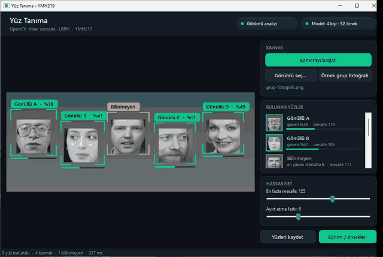
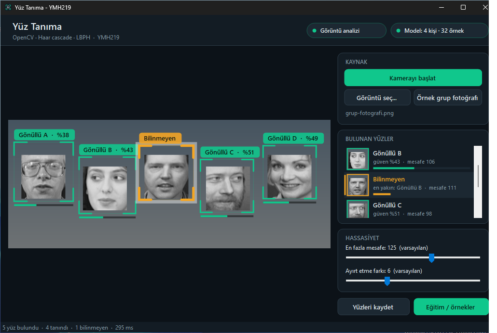
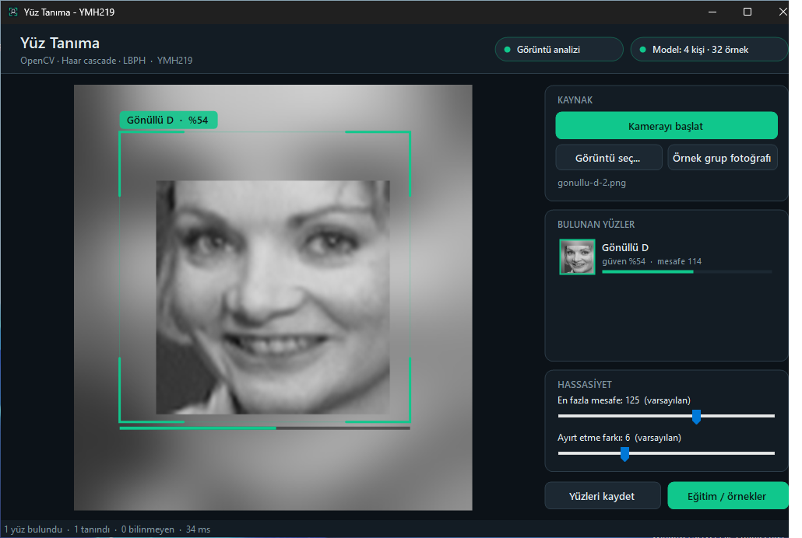
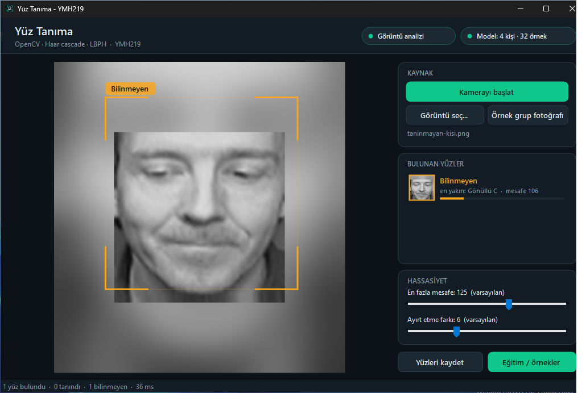
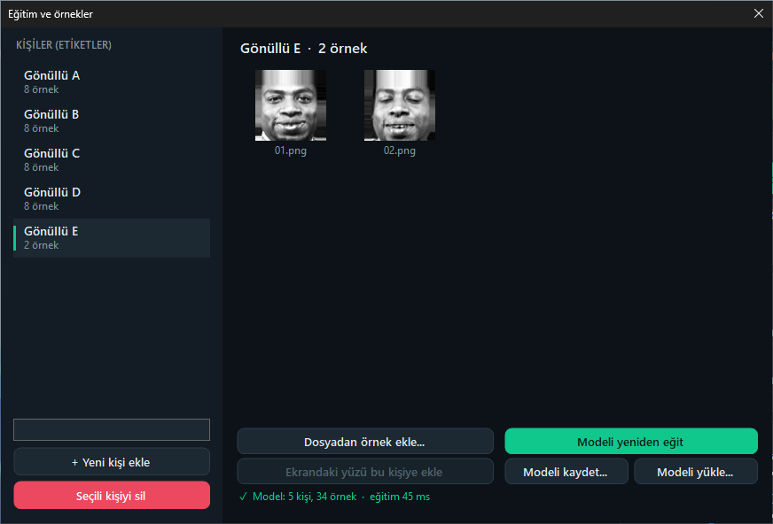
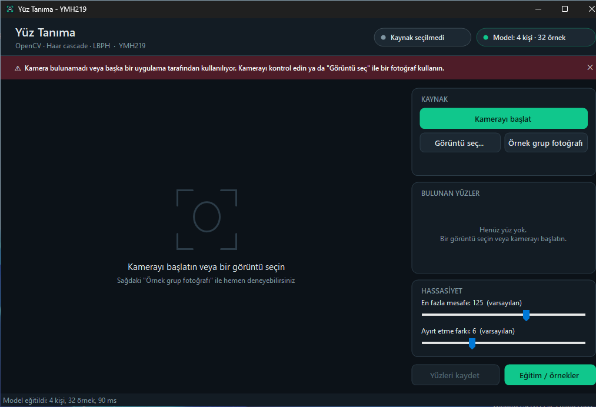
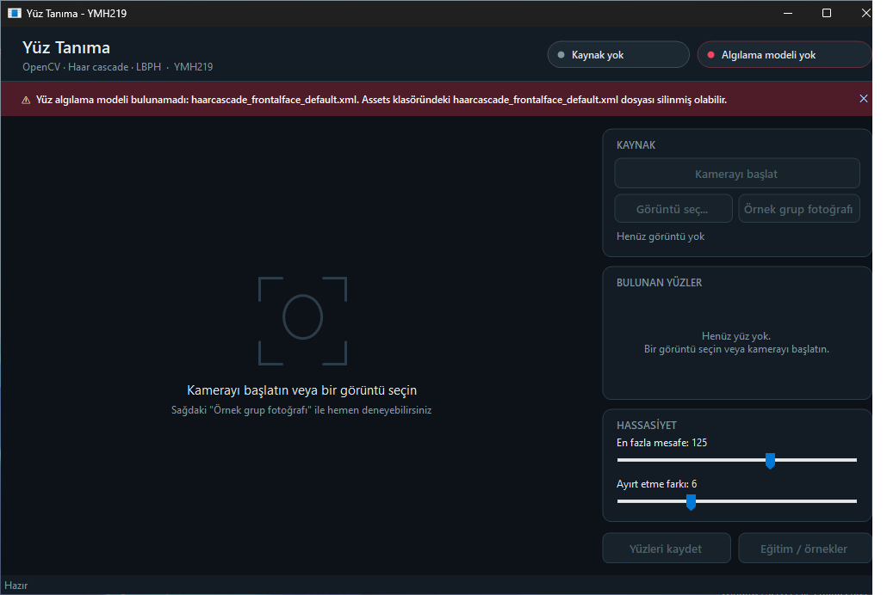
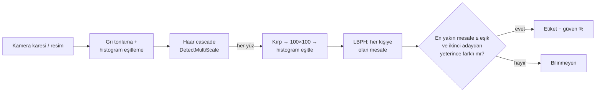

# YMH219 · OpenCV ile Yüz Algılama ve Tanıma

[](https://github.com/ozenyunus35/YMH219-FaceRecognition/actions/workflows/build.yml)


Kameradan veya dosyadan alınan görüntüde **yüzleri bulan** (Haar cascade), küçük bir yerel örnek kümesiyle
**kim olduğunu tahmin eden** (LBPH) ve sonucu güven skoruyla gösteren Windows Forms uygulaması.



**Öğrenci:** Yunus Emre Özen · 215542001 · YMH219 Nesne Tabanlı Programlama

---

## Hızlı bakış

| Föydeki madde | Durum | Nerede? |
|---|:-:|---|
| Kamera görüntüsü veya seçilen resim uygulamada gösterilir | ✅ | `PictureBox`'tan türetilen `AnalysisPictureBox` |
| Algılanan yüz dikdörtgen ile işaretlenir | ✅ | köşeli çerçeve + etiket + güven çubuğu |
| En az iki örnek sınıf ile tanıma gösterimi | ✅ | 4 gönüllü (Gönüllü A–D), kişi başı 8 örnek |
| Tahmin edilen etiket ve güven skoru | ✅ | resmin üstünde ve sağdaki listede |
| Kamera Başlat/Durdur ve Görüntü Seç | ✅ | sağ panel, "Kaynak" kartı |
| Kamera veya model dosyası yoksa hata bildirimi | ✅ | üstte kapatılabilir uyarı şeridi, uygulama kapanmaz |
| *İsteğe bağlı:* algılanan yüzleri klasöre kaydetme | ✅ | "Yüzleri kaydet" |
| *İsteğe bağlı:* birden fazla yüzü aynı karede işaretleme | ✅ | grup fotoğrafı: 5 yüz |
| *İsteğe bağlı:* basit eğitim / veri ekleme ekranı | ✅ | "Eğitim / örnekler" penceresi |

**Ekstralar:** "Bilinmeyen" kişi tespiti, canlı hassasiyet ayarı, modeli kaydet/yükle, Türkçe karakterli dosya yolu desteği,
42 otomatik test ve yabancı yüz değerlendirmesi.

## Ekran görüntüleri

| Grup fotoğrafı: 4 gönüllü tanındı, 1 kişi bilinmiyor | Tek kişi |
|:-:|:-:|
|  |  |

| Eğitimde olmayan kişi → Bilinmeyen | Eğitim penceresi |
|:-:|:-:|
|  |  |

| Kamera bulunamadığında | Algılama modeli silinmişse |
|:-:|:-:|
|  |  |

> Görüntüler GitHub Actions'ın Windows makinesinde uygulama çalıştırılarak alındı. O makinede kamera olmadığı için
> canlı kamera görüntüsü yok; kamera modu bilgisayarınızda **Kamerayı başlat** ile çalışır.

## Nasıl çalışıyor?



1. **Algılama:** `CascadeClassifier` + `haarcascade_frontalface_default.xml` (OpenCV ile gelen hazır model).
2. **Tanıma:** Her kişi için ayrı bir `LBPHFaceRecognizer`. Böylece yüzün **her kişiye** olan mesafesi biliniyor.
3. **Bilinmeyen kararı:** İki koşul var: en yakın kişiye mesafe eşikten küçük olmalı **ve** en yakın ile ikinci en yakın
   arasındaki fark yeterli olmalı. Yabancı yüzler genelde herkese benzer uzaklıkta kaldığı için ikinci koşul onları ayıklıyor.
4. **Eğitim örnekleri** de aynı adımlardan geçiyor: örnek fotoğraftaki yüz bulunup kırpılıyor. İlk denemede eğitim tüm
   fotoğrafla, tanıma kırpılmış yüzle yapılıyordu ve herkes "Bilinmeyen" çıkıyordu; testler bunu yakaladı.

### Sınıflar

| Sınıf | Görevi |
|---|---|
| `FaceDetector` | Haar cascade ile yüz bulma (model dosyası yoksa `VisionException`) |
| `FaceRecognizerService` | Kişi başı LBPH modelleri, eğitim, tahmin, kaydet/yükle |
| `FaceAnalyzer` | Algılama + tanımayı birleştirir, her yüz için `FaceMatch` döner |
| `CameraService` | `VideoCapture` ile arka planda kare okuma, `FrameReady` olayı |
| `SampleLibrary` | `Ornekler/<kişi>/*.png` klasör yapısı: kişi ekle/sil, örnek ekle |
| `ImagePreprocessor`, `ImageIO` | Gri/100×100/eşitleme; Türkçe karakterli yollar için güvenli okuma-yazma |
| `MainForm`, `TrainingForm` | Arayüz |

## Sonuçlar ve doğruluk

Testler GitHub Actions'ta her push'ta çalışıyor:

| Ölçüm | Sonuç |
|---|---|
| Gönüllülerin eğitimde **kullanılmayan** 8 fotoğrafı | **8 / 8 doğru kişi** |
| Grup fotoğrafı (5 yüz) | 5/5 yüz algılandı · 4 gönüllü doğru · yabancı kişi "Bilinmeyen" |
| Eğitimde olmayan **36 kişinin 72 fotoğrafı** | **48'i (%67)** doğru şekilde "Bilinmeyen", kalanı yanlışlıkla bir gönüllüye benzetildi |

Son satır bu yöntemin gerçek bir sınırını gösteriyor: kişi başı sadece 8 düşük çözünürlüklü fotoğrafla LBPH bazı
yabancıları tanıdık sanabiliyor. Sağ paneldeki **Hassasiyet** ayarlarıyla bu dengeyi kendiniz değiştirebilirsiniz.
Daha seçici bir ayar daha az yanlış eşleşme demek, ama tanıdık yüzlerin bir kısmı da "Bilinmeyen" çıkabilir.

## Kurulum ve çalıştırma

**Gereksinimler:** Windows 10/11 (64 bit), .NET 10 SDK veya Visual Studio 2026.
NuGet paketleri derlemede otomatik iner: `OpenCvSharp4`, `OpenCvSharp4.runtime.win`, `OpenCvSharp4.Extensions`.

```bash
git clone https://github.com/ozenyunus35/YMH219-FaceRecognition.git
cd YMH219-FaceRecognition
dotnet run --project FaceRecognition
```

Visual Studio: `YMH219-FaceRecognition.sln` → <kbd>F5</kbd>.

**Kullanım:**
1. **Örnek grup fotoğrafı**'na basın: 5 yüz çerçevelenir, 4'ü tanınır.
2. **Görüntü seç...** ile `DenemeGorselleri` klasöründen başka fotoğraflar deneyin.
3. **Kamerayı başlat** ile canlı görüntüde yüz algılama yapın.
4. **Eğitim / örnekler** penceresinden yeni bir kişi ekleyip fotoğraflarını yükleyin ve **Modeli yeniden eğit**'e basın.

**Kullanım ipuçları:**
- Sağdaki listede bir yüze tıklayınca o yüz resimde vurgulanır; resimdeki bir yüze tıklamak da listede seçer.
- Hassasiyet kaydırıcılarına çift tıklamak varsayılan değere (125 / 6) döndürür.
- Hata mesajları ✕ veya `Esc` ile kapanır; başarı mesajları birkaç saniye sonra kendiliğinden kapanır.
- Eğitim penceresinde yeni kişi kutusunda `Enter` kişiyi ekler, listede `Delete` seçili kişiyi (onay sorarak) siler, `Esc` pencereyi kapatır.
- Örnekler değişip model yeniden eğitilmediyse ana pencerede "yeniden eğitim gerekli" uyarısı görünür.

## Veri seti, etik ve gizlilik

- Gerçek kişilerden izinsiz fotoğraf **kullanılmadı**. Örnekler, yüz tanıma eğitiminde standart olan, gönüllülerden
  oluşan **ORL / Olivetti** araştırma veri setinden (AT&T Laboratories Cambridge) alındı. Ayrıntılar: [VERI_SETI.md](VERI_SETI.md)
- Kişiler kimlikleriyle değil, sadece "Gönüllü A/B/C/D" gibi anonim etiketlerle tanınıyor.
- Uygulama hiçbir görüntüyü ağa göndermiyor. Kayıt yalnızca kullanıcı **Yüzleri kaydet** dediğinde, seçtiği klasöre yapılıyor.
- Ders kapsamında yalnızca yerel ve izinli örneklerle kullanılmak üzere hazırlandı. İzinsiz kimlik takibi veya gizli
  görüntü toplama amacıyla kullanılmamalıdır.

## Testler

```bash
dotnet test
```

**42 test:** model dosyası yok/bozuk, tek ve çoklu yüz algılama, boş görüntü, 8 tanıma testi, yabancı yüz, grup fotoğrafı,
model kaydet/yükle, eğitilmemiş model, tek kişiyle eğitim reddi, güven skoru, örnek kütüphanesi (ekleme, üzerine yazmama,
geçersiz etiket, bozuk dosya atlama), yüz kırpıp kaydetme, kamera yoksa anlaşılır hata ve 72 fotoğraflık değerlendirme.

## Bilinen sınırlamalar

- LBPH basit bir yöntem; ışık, açı ve gözlük gibi farklar sonucu etkiler. Küçük örnek kümesinde yabancı yüz ayırt etme ~%67.
- Haar cascade yalnızca **önden** bakan yüzleri iyi bulur; yan profil algılanmayabilir.
- Uygulama Windows Forms ve OpenCV'nin Windows paketini kullandığı için **Windows 64 bit** üzerinde çalışır.
